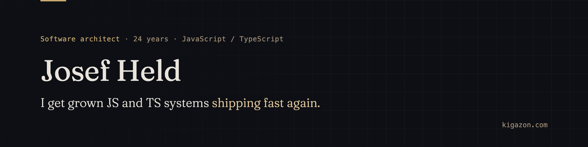

Most of my work now runs through coding agents, so I build the tools I was missing for them.

Founder of [Kigazon Enterprises GmbH](https://kigazon.com) · Deutschlandsberg, Austria

#### What I am building

| | | Status |
|---|---|---|
| **[MAICA](https://kigazon.com/maica.html)** | Run Claude Code and Codex in parallel. MAICA tells you when and where a session needs you and brings you back to it. | Private beta · [issues](https://github.com/josefheld/maica/issues) |
| **[DevReceipt](https://kigazon.com/devreceipt.html)** | For developers who work for clients: a short delivery brief from your Git history and time records, backed by an evidence ledger. Local-first. | Private beta · [issues](https://github.com/josefheld/devreceipt/issues) |
| **[claude-plugins](https://github.com/josefheld/claude-plugins)** | Five Claude Code plugins: statusline, update-plugins, llm-council, cc-changelog, fal-image-generator. | Open source |

```
/plugin marketplace add josefheld/claude-plugins
```

#### Fixed-fee engagements

| | |
|---|---|
| **[Codebase Decision](https://kigazon.com/audit.html)** | Refactor, rewrite or ship as-is? A decision on your JS/TS codebase in 3 days, with fix backlog and decision meeting. |
| **[Software-Fahrplan](https://kigazon.com/software-fahrplan.html)** | Technical start plan for building your own software with Codex or Claude: stack, data protection, project rules, start guide. |
| **[Produktiv-Check](https://kigazon.com/produktiv-check.html)** | Find out where productivity is being lost in your workflows and identify practical opportunities for improvement. |

Service descriptions are in German. Engagements are available in both German and English.

#### Where else I help

25+ years in software development and architecture. I help companies make sound technical decisions, build reliable software, and deliver with confidence.

- **Legacy JS/TS modernization** — Reduce technical debt, simplify architecture, and improve maintainability and delivery.
- **Interim CTO & technical leadership** — Technical strategy, architecture decisions, and hands-on leadership without a full-time hire.
- **AI-assisted development** — Integrate Claude Code, Codex, and coding agents into development workflows while maintaining code quality and control.
  
I write about this (in German) at [kigazon.com/blog](https://kigazon.com/blog.html).
[LinkedIn](https://www.linkedin.com/in/josef-held) · [30-minute call](https://cal.eu/josefheld/consultation30min)
